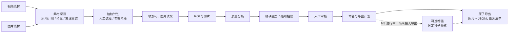

# Free-Train

[](#当前进度)
[](https://tauri.app)
[](https://www.rust-lang.org)
[](https://svelte.dev)
[](https://pnpm.io)
[](./LICENSE)

> ⚠️ **项目状态：开发中（Work In Progress），尚未开发完，也没有发布过可用安装包。**
>
> 作者时间有限，项目在完成 M4（质量、相似与审核）后停在了 M5（增强、命名和追溯导出）的第一条纵向交付上：
> M5 只完成了增强配方、固定种子预览和逐变体溯源，正式增强导出、完整命名与 CSV 清单尚未实现；
> M6（恢复、性能、安装与发布）和 M7（MCP、高级增强）尚未开始。
> 因此**请不要把它当作生产可用工具**：它没有安装包、没有 CI、没有性能基线，只有在开发机上跑通过的源码和本地自动化测试。

## 当前进度

进度以 [`docs/IMPLEMENTATION-PLAN.md`](./docs/IMPLEMENTATION-PLAN.md) 的 8 个里程碑为准，依据为各阶段实现报告与 [`docs/M4-GATE-REVIEW.md`](./docs/M4-GATE-REVIEW.md)：

| 里程碑 | 状态 | 实际进展 |
|---|---|---|
| M0 技术验证与仓库初始化 | ✅ 已完成 | Rust workspace、Tauri 2 + Svelte 桌面空壳、100,000 条 SQLite/虚拟网格探针、精简 FFmpeg 运行时方案均已验证；**NSIS 安装包未生成**（Tauri 内部下载工具包的请求被外部网络阻塞，见 M0 报告 4.1） |
| M1 项目、素材与基础预览 | ✅ 已完成 | `.ftproj` 项目、原地引用导入、快速指纹与后台 SHA-256、离线检测与重新定位、缩略图与真实预览；报告同时记录拖放运行态和窗口像素级截图未自动完成 |
| M2 视频抽帧与人工筛查 | ✅ 已完成 | 播放/逐帧/变速/跳转、人工抽帧默认锁定、有效片段、五种自动抽帧模式、画面变化曲线、来源组批量抽帧；M2 报告结论为"待人工窗口验收"，仓库中没有后续单独关闭 M2 人工验收的记录 |
| M3 ROI、切图与基础导出 | ✅ 已完成 | 多命名矩形 ROI、切片尺寸/重叠/边缘/填充策略、预览与正式导出共用坐标计划、JPEG/PNG/WebP、命名模板基础版、原子导出与 JSONL 来源清单 |
| M4 质量、相似与审核 | ✅ 已完成 | 客观质检、SHA-256 精确重复、pHash + SSIM 近重复、相似组与代表图、可撤销可重做的人工审核、100,000 项虚拟滚动；工程门禁与真实素材人工验收均已通过 |
| M5 增强、命名和追溯导出 | 🚧 进行中 | 只完成第一条纵向交付：版本化增强配方（Schema v7）、`rust-basic-v1` 四个基础算子、1-16 个固定种子变体预览与逐变体溯源。正式增强导出、配色/模糊/噪声/压缩等其余算子、配方管理 UI、完整命名与 CSV 清单均未开始 |
| M6 恢复、性能、安装与内部发布 | ⬜ 未开始 | 完整任务状态机与检查点恢复、缓存 DAG 精确失效、性能基线、Windows 安装包与便携版、许可证清单与发布说明均未开始 |
| M7 MCP 与高级增强（MVP 后） | ⬜ 未开始 | 仅有设计文档 [`docs/MCP-DESIGN.md`](./docs/MCP-DESIGN.md) 与 ADR，没有实现 |

按里程碑计数：**5 个已完成（M0-M4）、1 个进行中（M5）、2 个未开始（M6、M7）**。状态表不折算成完成度百分比，各阶段具体做到哪一步请看对应报告。

## 这是什么

Free-Train 是一个面向计算机视觉数据准备的 **Windows 本地离线预处理工具**，用于把未标注的视频和图片转换成可审核、可追溯、可送入标注流程的未标注图片：

- 输入：视频（抽帧）与图片（导入），默认原地引用，**永不修改或删除源素材**。
- 处理：人工筛查、ROI 与固定尺寸切图、客观质量分析、视觉近重复分组、可选数据增强。
- 输出：经过人工确认的图片，加上把每张图片追溯回源素材、时间戳、ROI、切片坐标、处理参数和审核状态的 JSONL 清单。

它只做"标注之前"这一段：**不负责标注、不划分 train/validation/test、不训练也不推理模型**。首版定位是单用户、内部使用的桌面工具，运行时不带 Python、Qt、OpenCV、Node.js 或 Chromium。

## 核心能力

以下能力按当前代码（`crates/` + `apps/desktop/`）整理；标注为「**限制**」的部分是尚未完成或尚未接通的能力。

### 项目与素材

- 创建、打开、重开 `.ftproj` 项目目录；项目内包含 `project.json`、`project.db`、`cache/`、`backups/`，会话期间持有独占写锁。
- 文件/多文件/目录选择与拖放导入，支持 JPEG、PNG、BMP、TIFF、WebP 与 MP4、MOV、MKV、AVI、WebM、M4V、MTS、M2TS。
- 原地引用 + 64 KiB 首尾快速指纹 + 后台 SHA-256；素材被移动或替换时标记为离线，可重新定位，不丢失 ROI、候选和审核历史。
- 来源组、来源标识、EXIF 方向与拍摄时间、中文/空格/Unicode 长路径。

### 视频抽帧与人工筛查

- 播放、暂停、逐帧、0.25x-2x 变速、时间轴拖动与时间跳转；不兼容 WebView2 的编码会在项目缓存里生成 H.264 预览副本。
- 人工抽帧（按钮或 `C`）记录实际解码时间戳，候选默认锁定；同一时间点重复保存不新增记录。
- 入点/出点有效片段（`I`/`O`），片段可删除、可跳转。
- 五种自动抽帧：固定时间间隔、固定帧间隔、目标数量均匀抽取、有效片段内抽取、画面变化触发；支持来源组批量执行、预估与新增/已存在/失败统计。
- 画面变化曲线：FFmpeg 降采样灰度帧 + Rust 归一化差异，只用于选择候选时间点，不冒充 AI 事件识别。

### ROI 与切图

- 多命名矩形 ROI，支持来源组预设与来源级同名覆盖；画布拖拽或 X/Y/宽/高精确输入。
- 切片尺寸、横纵重叠、丢弃/填充/贴边三种边缘策略，常量/边缘复制/反射三种填充，多种缩放与适配策略。
- 预览与正式导出调用同一套切片坐标计划；单个切片可从本次导出中排除。

### 质量、近重复与人工审核

- 客观测量：分辨率与宽高比、Laplacian 方差清晰度、欠曝/过曝比例、灰度熵与低信息量；可配置阈值、阈值分布条、预计影响数量、按指标排序。
- 相似筛选：项目级 SHA-256 精确重复 → pHash 召回 → SSIM 临界确认 → 图连通分量相似组；默认只在同来源、同 ROI、同切片位置、视频时间窗口内比较。
- 基于质量分数的确定性代表图，锁定项优先，多锁定冲突会显式提示。
- 人工保留/排除/恢复/锁定/解锁/更换代表图，自动建议与人工决定分离，重算不覆盖人工决定；审核操作有持久化撤销/重做和审计事件。
- 审核网格按状态/来源/相似组筛选、批量操作、浅白蒙层建议排除、绿色边框代表图、并排对比同步缩放；窗口化虚拟滚动覆盖 100,000 项基线。
- 顶部"快速处理"串联必要抽帧、切片准备、质量与相似分析，完成后停在审核工作台，**不会自动导出**。

### 增强（M5 进行中，仅预览）

- 版本化增强配方（Schema v1，项目数据库 Schema v7），`rust-basic-v1` 执行器支持亮度、对比度、水平翻转、顺时针 90° 旋转。
- 每个算子可设启用状态、概率和参数范围，按配方数组顺序执行；每张切片可生成 1-16 个变体，基础种子与资产键、变体序号共同派生实际种子。
- 每个预览记录输入资产键、配方版本、变体序号、实际种子、实际参数、执行器版本、`lineage_group_id` 和内容 SHA-256。
- **限制**：预览只写入项目缓存，不修改源素材，**也没有接入正式导出**——导出页目前仍是干净导出。

### 命名与导出

- 命名模板 AST：`{source}`、`{source_group}`、`{source_identifier}`、`{timestamp_ms}`、`{roi}`、`{row}`、`{col}`、`{width}`、`{height}`、`{index}`；Windows 非法字符与保留设备名清理。
- 追加序号、追加短哈希、跳过、失败四种重名策略；先出导出计划再执行。
- JPEG/PNG/WebP 输出，临时文件 + 原子重命名，同步写出带内容哈希的 JSONL 来源清单。
- 导出范围：当前素材、来源组、已选素材；可导出候选原图或 ROI 切片。
- **限制**：没有 CSV 清单和任务报告，命名模板字段也未覆盖 PRD 要求的全部字段（拍摄时间证据、处理时间、增强变体、血缘组、导出模式、可配置序号位数）。

### 长任务与可追溯

- 导入、来源移除、抽帧、切片准备、审核分析、导出都有进度事件，支持暂停/继续/取消；取消保留已原子完成的结果。
- 长任务控制器独立于项目会话锁，同一时间只允许一个受控长任务，避免多路解码/导出争抢磁盘。
- 源素材只读：所有导出、审核、增强操作都不改变源文件，测试中用 SHA-256 前后比对验证。

## 处理流程

下图按 [`docs/ARCHITECTURE.md`](./docs/ARCHITECTURE.md) 的流水线 DAG 和实际 crate 划分绘制；虚线部分是已实现但尚未接入导出链路的增强预览。



模块职责大致对应：

| 阶段 | 实现位置 |
|---|---|
| 素材探测、抽帧计划、审核、ROI、导出、增强 | `crates/application/`（`sampling.rs`、`review.rs`、`roi.rs`、`export.rs`、`augmentation.rs` 等） |
| 图片解码、切片渲染、质量指标、pHash/SSIM、基础增强算子 | `crates/image-pipeline/` |
| FFmpeg/ffprobe 子进程 | `crates/media/` |
| SQLite 迁移与仓储（当前 Schema v7） | `crates/storage/` |
| 领域类型与任务状态机 | `crates/domain/`、`crates/job-engine/` |
| 界面与 Tauri 命令桥接 | `apps/desktop/src/`、`apps/desktop/src-tauri/src/lib.rs` |

## 仓库结构

```text
Free-Train/
├─ apps/
│  └─ desktop/                  # 桌面端：SvelteKit 界面 + Tauri 2 壳
│     ├─ src/                   # 工作台页面（routes/+page.svelte）、前端工具与 node:test 测试
│     ├─ src-tauri/             # Tauri 命令桥接、窗口/CSP/打包配置（src/lib.rs 调用应用服务）
│     └─ static/                # 图标等静态资源
├─ crates/
│  ├─ domain/                   # 纯领域类型与规则：ROI、切片配置、任务状态机
│  ├─ application/              # 应用服务：项目/素材、抽帧、ROI、审核、增强、导出
│  ├─ storage/                  # SQLite 迁移与仓储（Schema v7），单写者串行访问
│  ├─ media/                    # ffprobe/ffmpeg 适配器（含 examples/probe 探针）
│  ├─ image-pipeline/           # 解码、切片、质量指标、pHash/SSIM、基础增强算子
│  └─ job-engine/               # 精简任务状态机（完整队列/检查点恢复属于 M6）
├─ resources/ffmpeg/            # FFmpeg 运行时说明；二进制不入库，仅留 .gitkeep
├─ scripts/fetch-ffmpeg-lgpl.ps1 # 下载并校验 BtbN LGPL shared 构建到 resources/ffmpeg/runtime
├─ docs/                        # PRD、架构、界面、测试计划、里程碑报告与 ADR
├─ tests/fixtures/              # 测试媒体夹具（m0-sample.mp4）
├─ CONTEXT.md                   # 领域语言：源素材、候选图片、切片、相似组等术语
├─ Cargo.toml                   # Rust workspace 与依赖版本
├─ package.json                 # 工作区脚本（通过 Corepack 调用 pnpm）
├─ pnpm-workspace.yaml          # pnpm workspace（apps/*）
└─ rust-toolchain.toml          # 固定 Rust 1.97.1，含 clippy/rustfmt
```

## 开发环境与构建

### 环境要求

- Windows 10/11（桌面壳依赖系统 WebView2；M0 验证记录为 WebView2 146.x）。
- Rust **1.97.1**：由 `rust-toolchain.toml` 固定（`channel = "1.97.1"`，`profile = "minimal"`，含 `clippy`、`rustfmt`）；`Cargo.toml` 中 `rust-version = "1.97"`、`edition = "2024"`。
- Node.js + Corepack：`package.json` 声明 `packageManager: pnpm@10.14.0`，因此不需要全局安装 pnpm，用 `corepack pnpm ...` 调用即可。M0 验证使用的 Node.js 为 24.14.1；Node 只用于开发和构建，不进入运行包。
- FFmpeg/ffprobe：仓库不提交二进制，打包或需要视频功能前先执行脚本准备运行时。

```powershell
# 首次安装前端依赖
corepack pnpm install

# 下载并校验 LGPL shared 版 FFmpeg / ffprobe 到 resources/ffmpeg/runtime
.\scripts\fetch-ffmpeg-lgpl.ps1
```

### 命令来源

下表每条命令都从仓库内的脚本或配置核实，而不是凭记忆编写：

| 命令 | 作用 | 依据 |
|---|---|---|
| `corepack pnpm install` | 安装前端依赖 | 根 `package.json` 的 `packageManager` 字段、`pnpm-workspace.yaml` |
| `corepack pnpm dev` | 只启动 Vite 前端（默认 1420 端口） | 根 `package.json` 的 `dev` → `apps/desktop` 的 `dev`（`vite dev`） |
| `corepack pnpm check` | Svelte/TypeScript 类型检查 | 根 `package.json` 的 `check` → `apps/desktop` 的 `check`（`svelte-kit sync && svelte-check`） |
| `corepack pnpm --dir apps/desktop test` | 前端单元测试 | `apps/desktop/package.json` 的 `test`（`node --test src/lib/*.test.mjs`） |
| `cargo test --workspace` | Rust 全工作区测试 | 根 `Cargo.toml` 的 workspace 成员列表 |
| `corepack pnpm tauri dev` | 启动桌面开发窗口 | 根 `package.json` 的 `tauri` → `apps/desktop` 的 `tauri`；`tauri.conf.json` 的 `beforeDevCommand`（`corepack pnpm dev`）与 `devUrl`（`http://localhost:1420`） |
| `corepack pnpm tauri build --no-bundle` | 构建 release EXE（不生成安装器） | `tauri.conf.json` 的 `bundle` 配置；M0/M1 报告记录的发布构建产物是单文件 release EXE（5.19-6.62 MiB），从未生成过安装器 |
| `cargo fmt --all -- --check` | Rust 格式检查 | M4 门禁评审记录的门禁命令 |
| `cargo clippy --workspace --all-targets -- -D warnings -A clippy::too_many_arguments` | Clippy 门禁 | [`docs/M4-GATE-REVIEW.md`](./docs/M4-GATE-REVIEW.md) 与 [`docs/M5-REPORT.md`](./docs/M5-REPORT.md) 记录的命令 |

> 说明：本次重写 README 时**没有在干净环境重新执行**这些命令；上面的测试数字来自各里程碑报告的自报结果。

### 自动化与门禁记录

以下是各里程碑报告记录的结果，用于说明代码在提交时处于什么状态，不构成对当前 HEAD 的保证：

- M4 门禁（2026-08-04）：`cargo test --workspace` 46 项通过、Clippy 通过、前端 5 项测试通过、`svelte-check` 0 错误 0 警告、生产构建通过、`cargo fmt` 与 `git diff --check` 通过。
- M5 第一条交付：`cargo test --workspace` 50 项通过、Clippy 通过、前端 5 项测试与生产构建通过。
- 仓库**没有配置 CI**（没有 `.github/`），以上门禁全部依赖本地手动执行。

## 上手：当前可跑通的流程

界面左侧有素材、处理、审核、导出、任务五个工作区；**"任务"和顶部"设置"目前是禁用占位**，悬停提示为"将在后续里程碑接入"。已接通的是前四个：

1. 新建或打开一个 `.ftproj` 项目。
2. 点击"导入"选择文件/目录，或把视频、图片拖入窗口；在左侧来源树选择素材，中间预览，右侧查看来源、媒体与指纹信息。素材移动后点刷新，离线素材可"重新定位"。
3. 视频：用播放/逐帧/变速/时间跳转定位，按 `C` 保存当前帧（默认锁定），按 `I`/`O` 标记有效片段；在右侧"抽帧"页选择固定时间、固定帧间隔、目标数量、有效片段或画面变化模式，**先预估再抽帧**。
4. 处理 → "ROI / 切图"：在画布拖拽新建 ROI 或用 X/Y/宽/高精确调整，配置切片尺寸、重叠率与边缘策略，点"应用并预览"。
5. 顶部"快速处理"或左侧"审核"：配置最小尺寸、清晰度、曝光、低信息量阈值，选择相似比较范围与 pHash/SSIM 阈值，运行后在审核网格筛选、保留/排除/恢复/锁定、双击进并排对比。快速处理完成后停在审核工作台，不会自动导出。
6. 审核工作台右侧"增强预览"：为选中的合格切片配置 4 个基础算子、变体数量和基础种子，生成固定种子预览。这一步只写项目缓存，不影响导出。
7. 导出：选择范围（当前素材/来源组/已选素材）、原图或切片、输出格式与命名模板，检查导出计划后确认；导出图片与 JSONL 清单。

常用快捷键：`Space` 播放/暂停、`←`/`→` 逐帧、`C` 保存当前帧、`I`/`O` 入点/出点、审核 `K` 保留 / `X` 排除 / `R` 恢复 / `L` 锁定、`Ctrl+Z` / `Ctrl+Shift+Z` 撤销/重做、`Ctrl+S` 保存 ROI 或预览导出计划、增强页 `Ctrl+Enter` 生成预览。

## 文档索引

- [领域语言与术语](./CONTEXT.md)
- [产品需求文档（PRD）](./docs/PRD.md)
- [软件架构设计](./docs/ARCHITECTURE.md)
- [界面与交互设计](./docs/UI-DESIGN.md)
- [实施计划与里程碑](./docs/IMPLEMENTATION-PLAN.md)
- [测试计划](./docs/TEST-PLAN.md)
- 阶段报告：[M0 技术验证](./docs/M0-REPORT.md) · [M1 项目与素材](./docs/M1-REPORT.md) · [M2 抽帧与人工筛查](./docs/M2-REPORT.md) · [M3 ROI 与基础导出](./docs/M3-REPORT.md) · [M4 质量与审核](./docs/M4-REPORT.md) · [M4 阶段门禁评审](./docs/M4-GATE-REVIEW.md) · [M5 增强与命名（进行中）](./docs/M5-REPORT.md)
- [Application 模块拆分计划](./docs/APPLICATION-REFACTOR-PLAN.md)
- [MCP 接口预留设计](./docs/MCP-DESIGN.md)
- 架构决策记录：[ADR-0001 本地优先桌面架构](./docs/adr/0001-local-first-desktop.md) · [ADR-0002 Tauri/Svelte/Rust 技术栈](./docs/adr/0002-tauri-svelte-rust-stack.md) · [ADR-0003 原生 Rust 增强](./docs/adr/0003-native-rust-augmentation-with-optional-plugin.md)
- [FFmpeg 运行时说明](./resources/ffmpeg/README.md)

## 已知限制与未完成事项

这是本文档的重点部分：项目**没有开发完**，下面列出的是真实状态，而不是路线图式的愿望。

**功能上的缺口**

1. **M5 未完成**：增强只做到"预览"。正式增强导出没有接入同一执行器；颜色、Gamma、模糊、运动模糊、噪声、压缩损伤、雾化、暗角等 PRD 要求的算子都未实现；配方的创建、重命名、复制、删除、拖动排序也没有 UI：界面里只有一组固定的亮度/对比度/翻转/旋转参数，请求由前端按固定结构构造（应用层有 `list_augmentation_recipes`，但尚未作为界面能力暴露）。
2. **命名与追溯导出未完成**：命名模板字段有限（缺拍摄时间证据与格式、处理时间、增强变体标识、血缘组、导出模式、可配置序号位数）；没有 CSV 清单和任务报告；没有 PRD 要求的"实时文件名示例 + 全量冲突预检"交互（现有实现是在导出计划阶段处理重名）。
3. **任务/设置未接通**：左侧"任务"工作区和顶部"设置"按钮是禁用占位；任务队列、阶段检查点、中断恢复、缓存清理 UI 均未实现（M6 范围）。
4. **没有安装包与发布流程**：从未生成过 NSIS/MSI 安装包（M0 记录 Tauri 固定下载 NSIS 工具包被外部网络超时阻塞）；没做过 WebView2 检测引导、便携版、许可证清单和发布说明。
5. **MCP 未实现**：只有设计和 ADR；桌面 MVP 本身也不开放 MCP Server。

**工程与验证上的欠账**

6. **没有 CI**：仓库没有 `.github/`，门禁靠本地命令；提交历史里没有可复现的 CI 记录。
7. **性能基线缺失**：PRD 的目标（普通任务内存 < 4 GB、缓存命中切换接近 300 ms、标准安装包 40-70 MB）没有在真实规模素材上建立基线；目前只有 100,000 项虚拟网格、SQLite 尾页查询等自动化探针。
8. **人工验收留证不完整**：M1 报告记录拖放运行态与窗口截图未自动完成；M2 报告结论仍是"待人工窗口验收"；正式人工验收只在 M4 阶段做过一次（见 M4-GATE-REVIEW）。
9. **已知精度/交互保留项**（摘自 M2 报告）：变帧率视频的逐帧与固定帧间隔按平均帧率定位；有效片段只支持创建、跳转、删除，不支持拖拽移动与数值编辑；抽帧执行按来源串行，任务级并发/恢复留给 M6。
10. **平台与范围限制**：仅 Windows 10/11、单用户、内部使用；不处理标注、数据划分、训练与推理；相似筛选只做视觉近重复（SHA-256/pHash/SSIM），不使用 CLIP/DINO 等语义模型；不支持多边形或掩膜 ROI。

**元数据不一致**

11. `LICENSE` 文件是 MIT，但 Rust workspace 与前端包元数据仍写作 `UNLICENSED`（`Cargo.toml` 的 `workspace.package.license`、`apps/desktop/package.json` 的 `license`）。如果要公开发布，需要先统一这两处。

## Roadmap

以下内容直接来自 [`docs/IMPLEMENTATION-PLAN.md`](./docs/IMPLEMENTATION-PLAN.md) 的 M5-M7 工作项，是计划而非时间承诺（作者目前没有排期）：

1. **补完 M5**：扩充几何、光照、颜色、模糊、噪声、压缩和环境类算子；配方的增删改与排序 UI；把同一 `rust-basic-v1` 执行器接入显式的"增强导出"，默认仍为干净导出；补齐命名字段、全量冲突扫描和 JSONL/CSV 追溯清单。
2. **M6 恢复、性能、安装与内部发布**：完整任务状态机与阶段检查点、缓存 DAG 精确失效、并发与内存预算、性能基线、Windows 10/11 + DPI 视觉测试、Tauri 标准安装包与便携版、WebView2 检测引导、精简 FFmpeg 资源校验与许可证清单、项目升级备份、内部发布说明。
3. **M7（MVP 后）**：只读/计划类 MCP 工具 + 允许目录、权限分层与审计；Albumentations 隔离进程执行器；语义多样性分析；标注格式适配。这些都不属于首版基础包。

更细的验收条件和退出条件见实施计划的第 9-11 节；每个里程碑的"实际做到哪一步"以对应的 `docs/M*-REPORT.md` 为准。

## 许可证

仓库根目录的 [`LICENSE`](./LICENSE) 为 MIT。注意上面"元数据不一致"一条：构建元数据尚未同步，正式发布前需要先统一。第三方依赖、FFmpeg 运行时与前端包的许可证清单尚未整理进 `resources/licenses/`（M6 工作项）。
